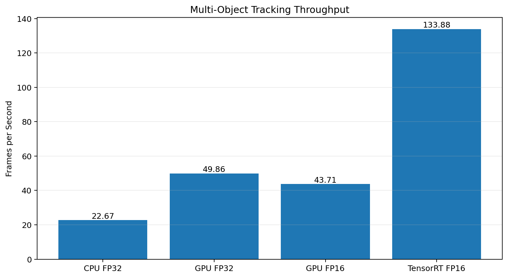
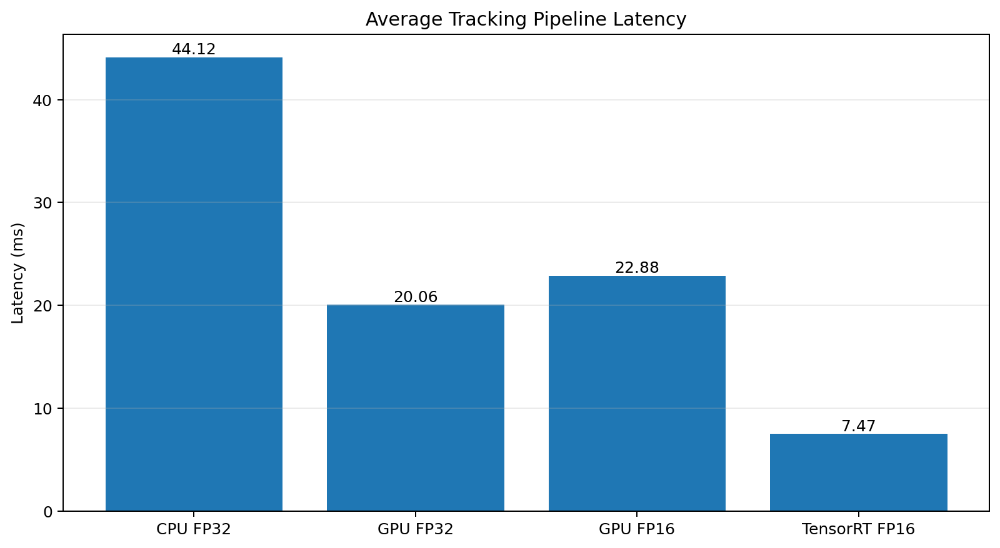
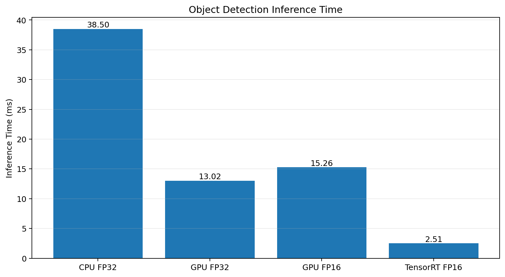
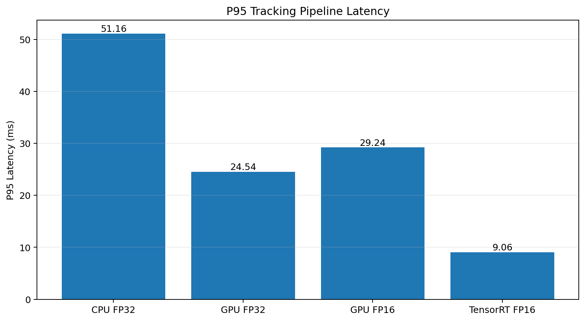

# EdgeTrack-AIPC

**Edge-Optimized Multi-Object Detection and Tracking for AI-PC-Class Hardware**

EdgeTrack-AIPC is a Computer Vision and Edge AI benchmarking project that investigates how hardware acceleration, numerical precision, and optimized inference backends affect the performance of real-time multi-object detection and tracking.

The pipeline combines **YOLO11n** for object detection with **ByteTrack** for multi-object tracking and benchmarks the same video sequence across CPU, PyTorch GPU, and TensorRT execution.

The goal is to study the **latency–throughput trade-offs of deploying real-time perception workloads on resource-constrained and AI-PC-oriented environments**.

---

## Key Result

TensorRT FP16 achieved **133.88 FPS**, compared with **22.67 FPS** for the CPU FP32 baseline.

This represents:

- **5.9× higher compute throughput**
- **83.1% lower average pipeline latency**
- Average latency reduced from **44.12 ms → 7.47 ms**
- Detection inference time reduced from **38.50 ms → 2.51 ms**
- P95 latency reduced from **51.16 ms → 9.06 ms**

---

## System Pipeline

```text
Video Input
     │
     ▼
┌───────────────────────┐
│   YOLO11n Detection   │
└───────────┬───────────┘
            │
            ▼
┌───────────────────────┐
│ ByteTrack MOT Tracker │
└───────────┬───────────┘
            │
            ▼
┌─────────────────────────────┐
│    Execution Optimization   │
├─────────────────────────────┤
│ CPU FP32                    │
│ PyTorch GPU FP32            │
│ PyTorch GPU FP16            │
│ TensorRT FP16               │
└─────────────┬───────────────┘
              │
              ▼
┌─────────────────────────────┐
│ Performance Benchmarking    │
├─────────────────────────────┤
│ Average Latency             │
│ Median Latency              │
│ P95 Latency                 │
│ Inference Time              │
│ Compute Throughput          │
└─────────────────────────────┘
```

---

## Benchmark Results

| Configuration | Avg Latency | P95 Latency | Inference | Throughput |
|---|---:|---:|---:|---:|
| CPU FP32 | 44.12 ms | 51.16 ms | 38.50 ms | 22.67 FPS |
| PyTorch GPU FP32 | 20.06 ms | 24.54 ms | 13.02 ms | 49.86 FPS |
| PyTorch GPU FP16 | 22.88 ms | 29.24 ms | 15.26 ms | 43.71 FPS |
| **TensorRT FP16** | **7.47 ms** | **9.06 ms** | **2.51 ms** | **133.88 FPS** |

---

## Throughput



TensorRT FP16 achieved approximately **5.9× the compute throughput of CPU FP32** and approximately **2.7× the throughput of PyTorch GPU FP32**.

---

## Average Latency



Moving from CPU execution to TensorRT FP16 reduced average detection-and-tracking latency from **44.12 ms to 7.47 ms**, representing an approximately **83.1% reduction**.

---

## Detection Inference



YOLO11n inference decreased from **38.50 ms on CPU FP32** to approximately **2.51 ms using the TensorRT FP16 engine**.

---

## P95 Latency



P95 latency is included to evaluate performance beyond average latency and provide insight into runtime stability.

TensorRT FP16 achieved approximately **9.06 ms P95 latency**, compared with **51.16 ms on CPU FP32**.

---

## Experimental Setup

### Hardware

- NVIDIA GeForce RTX 2080 Max-Q
- 8 GB GPU memory
- Windows
- CUDA-enabled environment

### Software

- Python 3.10
- PyTorch
- CUDA 12.8
- Ultralytics
- YOLO11n
- ByteTrack
- TensorRT 11
- OpenCV
- Pandas
- Matplotlib

### Benchmark Input

A fixed **525-frame MOT17-09 video sequence** was used for all benchmark configurations.

Using the same video input across experiments avoids the uncontrolled scene differences that occur when benchmarking directly from a live webcam.

The benchmark video is not included in this repository.

---

## Benchmark Methodology

Four execution configurations were evaluated:

1. **CPU FP32**
2. **PyTorch GPU FP32**
3. **PyTorch GPU FP16**
4. **TensorRT FP16**

All configurations process the same video sequence using the same YOLO11n detector, confidence threshold, and ByteTrack tracking configuration.

The first **10 frames are treated as warm-up frames** and excluded from steady-state performance statistics.

### Metrics

The benchmark records:

- Average pipeline latency
- Median pipeline latency
- P95 pipeline latency
- Detector inference time
- Compute throughput
- RAM usage
- Detection count
- Tracking count

Throughput is calculated as:

```text
Measured Frames
────────────────────────────
Total Measured Tracking Time
```

Video decoding and visualization are excluded from the timed region.

Therefore, reported FPS represents **compute throughput of the detection-and-tracking pipeline**, rather than complete camera-to-display application FPS.

---

## Optimization Analysis

### CPU → GPU

Moving the workload from CPU FP32 to PyTorch GPU FP32 increased throughput from:

```text
22.67 FPS → 49.86 FPS
```

This corresponds to approximately:

**2.2× higher compute throughput.**

Average latency decreased from:

```text
44.12 ms → 20.06 ms
```

---

### PyTorch FP32 → PyTorch FP16

An interesting result emerged when changing numerical precision.

PyTorch GPU FP16 did **not** outperform PyTorch GPU FP32:

```text
GPU FP32 : 49.86 FPS
GPU FP16 : 43.71 FPS
```

Average latency was also slightly higher:

```text
GPU FP32 : 20.06 ms
GPU FP16 : 22.88 ms
```

This demonstrates that reducing numerical precision alone does not necessarily improve end-to-end performance for a lightweight real-time tracking pipeline.

---

### TensorRT FP16

The largest improvement occurred after exporting YOLO11n to a TensorRT FP16 engine.

```text
CPU FP32
22.67 FPS
      │
      ▼
GPU FP32
49.86 FPS
      │
      ▼
TensorRT FP16
133.88 FPS
```

Compared with CPU FP32:

**5.9× higher compute throughput**

Compared with PyTorch GPU FP32:

**2.7× higher compute throughput**

This result highlights the importance of **backend-level graph and inference optimization**, rather than relying only on lower numerical precision.

---

## Detection and Tracking Consistency

Detected and tracked object counts remained similar across the benchmark configurations.

This provides a basic consistency check between execution modes.

However, object counts are **not an accuracy metric**.

Formal tracking-quality evaluation requires ground-truth annotations and metrics such as:

- MOTA
- IDF1
- HOTA

These metrics are outside the scope of the current performance-focused experiment.

---

## Research Question

> **What latency and throughput trade-offs result from changing execution device, numerical precision, and inference backend in a lightweight YOLO11n + ByteTrack multi-object tracking pipeline?**

The experiments demonstrate three important observations:

1. GPU acceleration provides a substantial performance improvement over CPU execution.
2. FP16 precision alone does not necessarily improve end-to-end tracking performance.
3. TensorRT backend optimization provides the largest performance improvement in the tested environment.

---

## Repository Structure

```text
EdgeTrack-AIPC/
│
├── data/
│   └── benchmark.mp4          # Not included in repository
│
├── results/
│   ├── figures/
│   │   ├── throughput_comparison.png
│   │   ├── latency_comparison.png
│   │   ├── inference_comparison.png
│   │   └── p95_latency_comparison.png
│   │
│   ├── benchmark_final.csv
│   ├── cpu_fp32.csv
│   ├── gpu_fp32.csv
│   ├── gpu_fp16.csv
│   └── tensorrt_fp16.csv
│
├── benchmark_compare.py
├── benchmark_tensorrt.py
├── generate_charts.py
├── main.py
├── requirements.txt
└── README.md
```

---

## Running the Project

### 1. Create a virtual environment

```bash
python -m venv .venv
```

Activate it on Windows:

```bash
.venv\Scripts\activate
```

---

### 2. Install dependencies

```bash
pip install -r requirements.txt
```

A CUDA-enabled PyTorch installation is required for the GPU experiments.

---

### 3. Run the PyTorch benchmark

```bash
python benchmark_compare.py
```

This evaluates:

- CPU FP32
- GPU FP32
- GPU FP16

---

### 4. Export YOLO11n to TensorRT FP16

```python
from ultralytics import YOLO

model = YOLO("yolo11n.pt")

model.export(
    format="engine",
    device=0,
    half=True,
    imgsz=640
)
```

---

### 5. Run the TensorRT benchmark

```bash
python benchmark_tensorrt.py
```

---

### 6. Generate benchmark figures

```bash
python generate_charts.py
```

The generated figures are stored in:

```text
results/figures/
```

---

## Limitations

The current experiment focuses primarily on **runtime performance and deployment optimization**, not formal tracking accuracy.

Current limitations include:

- Single benchmark video sequence
- Single GPU architecture
- Single benchmark run per configuration
- No MOTA / IDF1 / HOTA ground-truth evaluation
- No NPU deployment
- No INT8 calibration
- No power-consumption measurements
- Video decoding is excluded from reported compute latency
- PyTorch-allocated VRAM should not be interpreted as total GPU memory consumption, particularly for TensorRT

---

## Future Work

Future experiments can extend the project with:

- TensorRT INT8 quantization
- OpenVINO optimization
- AI-PC NPU deployment
- MOTA / IDF1 / HOTA evaluation
- Multiple MOT benchmark sequences
- Occlusion-aware tracking experiments
- Power and energy-efficiency benchmarking
- Real-time camera deployment
- Hardware-aware adaptive inference

---

## Motivation

Modern AI PCs increasingly execute AI workloads locally.

Real-time perception workloads require balancing:

- Detection quality
- Tracking stability
- Latency
- Throughput
- Memory consumption
- Hardware constraints

EdgeTrack-AIPC provides a compact experimental framework for investigating these trade-offs using a real-time Computer Vision workload.

The project demonstrates how an AI pipeline can progress from a baseline implementation toward **hardware-aware, optimized edge inference**.